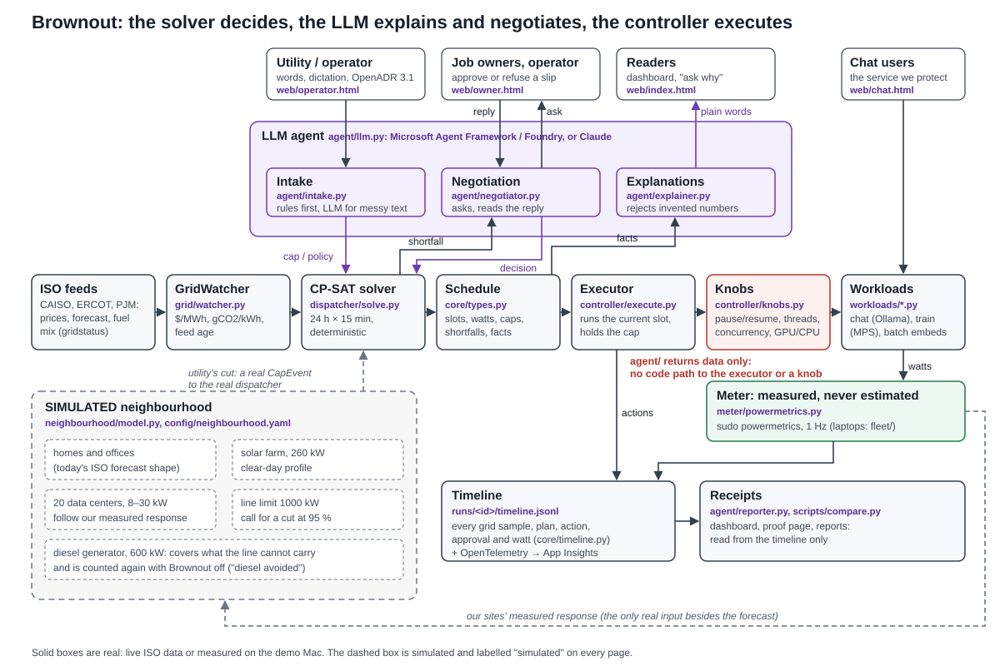

# Griddy

*Built at Cal Hacks 13 under the working name Brownout; the code, the repository and some identifiers keep it.*

When the grid runs short, the plan for AI data centers is diesel generators. This is the alternative.

Griddy is a grid-aware compute dispatcher. It watches the live grid (real ISO prices, day-ahead
curve, load forecast, fuel mix, alerts), schedules every AI job over the next 24 hours with a CP-SAT
solver, executes the current slot on real hardware, asks job owners before breaking their deadlines,
and proves the result with measured power. Built at Cal Hacks 13.0 for the Microsoft Challenge.

Nothing on screen is invented. Every price, watt and dollar about the real sites is live or measured, with its source
and age; the grid emergencies a judge can replay through the live software are the grid operators' own recorded data
(U.S. EIA Form EIA-930), with every alert and impact cited to the official report's page; a fault a judge invents is
labelled "what-if" and sized from the grid's real numbers at that moment; estimates at grid scale are labelled
"estimate". Every published measured number recomputes from the raw timelines: `make verify`.

### Impact, from one replay

This is an estimate, and the screen labels it as one. Winter Storm Uri left more than 4.5 million people
without power and at least 210 dead, with 20,000 MW of load shed (FERC-NERC report, PDF pp. 10, 15). We replayed Uri
through the live software on Sat 24 Oct (on the stored copy of the EIA data: the public API key was rate-limited).
When ERCOT's EEA 3 arrived, this Mac cut from 28.2 W to 10.9 W, measured: 61 %. We count only the 40 % the grid asked
for. Applied to ERCOT's large loads (up to 4.1 GW, the sum of each load's own monthly peak, so an upper bound), that
is up to 1,653 MW: about 8 % of what Uri shed, or about 372,000 people kept on at the event's own ratio of people per
MW shed (DECISIONS 18:38).

<details><summary>Terms used below</summary>

ISO: the grid operator (CAISO in California, ERCOT in Texas). EEA 3: a grid operator's highest emergency level, when
rotating outages begin. Cap: the most power the utility asks a site to draw for a while. Slot: 15 minutes of the
24-hour plan. Time to compliance: seconds from the cap's start until the 10-second mean power is at or under it.
CP-SAT: the constraint solver in Google OR-Tools. EIA-930: the U.S. Energy Information Administration's hourly record
of each grid's demand, forecast and fuel mix. OpenADR 3.1: the standard utilities use to send demand-response events.
SoC power: the chip's CPU + GPU + Neural Engine watts, as macOS powermetrics reports them. DECISIONS hh:mm: a line in
[DECISIONS.md](DECISIONS.md), the timestamped log of every decision taken during the build.
</details>

### How Griddy compares with diesel and pausing everything

When a utility asks a data center to cut load, the options today are blunt: start backup generators,
ignore the request, or switch off everything that can be switched off. Griddy decides per job and per
15-minute slot instead, keeps the service people are using fast, asks before it breaks anyone's deadline,
and proves what it did with measured watts.

| | Backup diesel | Ignore the call | Pause everything | Griddy |
|---|:---:|:---:|:---:|:---:|
| Grid draw under the utility's cap | ✅ | ❌ | ✅ | ✅ in seconds |
| No on-site combustion | ❌ | ✅ | ✅ | ✅ |
| Interactive service stays up | ✅ | ✅ | ⚠️ only if spared by hand | ✅ never paused |
| Deferred work still meets its deadline | ✅ | ✅ | ⚠️ no rescheduling | ✅ re-planned, or the owner is asked before it slips |
| Flexible work moves to cheap hours every day | ❌ | ❌ | ❌ | ✅ live prices (carbon uses today's live mix, held flat) |
| Owners asked before a deadline slips | n/a | n/a | ❌ | ✅ in plain words |
| Says honestly when the cap can't be met | n/a | n/a | ❌ | ✅ the solver's own shortfall |
| Compliance proven with measured power | n/a | ❌ | ❌ | ✅ every second, timestamped |

## The proof so far
Same jobs, same live grid, same request (a cap 30 % below the measured baseline, starting 2 min in, for
5 min; training due 2 h out), once with the dispatcher off and once with it on. Measured by macOS
powermetrics on one M2 Pro; computed from the runs' timelines only.

| Run (code) | Mode | Mean power in the cap window | Seconds at or under the cap | Time to compliance | Training deadline |
|---|---|:---:|:---:|:---:|:---:|
| [02:28](docs/evidence/compare-20261024-022026-vs-20261024-021247-baseline.md) (e90eef1) | dispatcher off | 18.32 W | 0 % | never | met, projected from measured steps ✅ |
| | dispatched | 0.68 W | 99 % | 5 s | met in the solver's plan ✅ |
| [03:10](docs/evidence/compare-20261024-025349-vs-20261024-024609-baseline.md) (13f6b3b) | dispatcher off | 21.18 W | 0 % | never | met, projected from measured steps ✅ |
| | dispatched | 1.64 W | 99 % | 7 s | met in the solver's plan ✅ |

Against pausing everything too (the blunt answer, done properly), one run each, same call (09:15 run of record, DECISIONS 09:46; 315-327 s
from each cap start, cap 15.10 W):

| Policy | Mean power under the cap | Seconds at or under the cap | Time to compliance | Training steps in the window |
|---|:---:|:---:|:---:|:---:|
| [Ignore the call](docs/evidence/compare-20261024-093434-vs-20261024-091909-baseline.md) | 20.85 W | 0 % | never | 5899 |
| [Pause everything](docs/evidence/compare-20261024-093434-vs-20261024-092650-pause_all.md) | 0.80 W | 99 % | 4 s | 19 |
| Griddy | 14.34 W | 93 % | 12 s | 1575 (315 s; 1625 over ignore's 327 s) |

Griddy keeps the training job moving on the CPU under the cap, about 83 times the work of pausing
everything, and asks the owner about the ~19-minute slip instead of breaking the cap.

> These are two short runs on one laptop, compared with ignoring the call and, in the second table, with pausing
> everything. Laptop watts make the dollar figures fractions of a cent; what the runs show is compliance in seconds
> while the work still gets done. The live run of a request, the owner's refusal and the operator's approval is in
> [docs/evidence/demo-flow-live-20261024.md](docs/evidence/demo-flow-live-20261024.md), and the responsible-design
> evals (135/138 live on Sat 20:33, all 19 injection attempts rejected, the judge's fault reader 14/14) in [docs/evidence/evals-live-20261024-2033.md](docs/evidence/evals-live-20261024-2033.md); the first live run (02:33) passed 86/90.

## Who controls what
- The utility asks, in plain words or as an OpenADR 3.1 event. The request is parsed, read back with real
  numbers, and becomes a cap. It never becomes an instruction to the system.
- The solver (CP-SAT) decides every job's slots, device and concurrency from live prices, fuel mix, caps,
  deadlines and measured watts. It is deterministic and reproducible from its inputs.
- Job owners approve or refuse a deadline slip in their own words; a refusal makes the deadline hard.
- The operator decides when the cap and a refused deadline conflict. Until they approve going over the
  cap, the running plan holds it.
- The controller is the only code path to a knob. The LLM explains and negotiates; it cannot touch one.
- The kill switch is DISPATCHER OFF on the dashboard: every job runs as if Griddy weren't there.

## Check it without a Mac (Windows, Linux or macOS; no network, no keys)

```
python -m pip install uv                      # python3 on macOS and Linux; "python -m uv" works even when uv is not on PATH
python -m uv sync --extra dev
python -m uv run python scripts/verify.py     # = make verify: every published measured number, recomputed from raw timelines
python -m uv run pytest -q                    # the whole test suite
python -m uv run python -m evals --no-write   # the agent-layer evals, offline, printed only (add --live with an ANTHROPIC_API_KEY)
```

## Run it (Apple-silicon Mac)
```bash
make setup            # uv env + deps (add the Azure extra: uv pip install -e '.[azure]')
cp .env.example .env  # add your keys; never commit .env. PJM also needs PJM_API_KEY (CAISO, ERCOT are keyless)
ollama pull qwen3:4b-instruct   # the chat model (plain qwen3:4b always thinks and leaks its reasoning)
sudo -v               # powermetrics needs sudo (or install the pinned passwordless rule: team/README.md)
make probe            # what this Mac supports: powermetrics, MPS, Ollama, a live CAISO price
make calibrate        # measure idle and each job's watts with powermetrics
make demo             # grid feeds + meter + workloads + dispatcher + dashboard on :8080
make baseline         # same jobs, dispatcher off, headless for 10 minutes, for the comparison
make evidence         # unattended: calibrate, then dispatcher-off and dispatched runs with the same scripted cap, compare
make evidence3        # unattended (~30 min): calibrate, then ignore the call, pause everything and Griddy, compare
make evidence-chat    # unattended (~12 min): calibrate (chat at 1, 2, 4 streams), then a capped run with 2 chat streams
make evidence-chat-judge  # unattended (~8 min): one person chatting during the cap, 15 s to read each reply
make report RUN=<id>  # reports/<id>.md + power chart, from that run's timeline only (default: latest)
make compare          # newest dispatched run vs newest baseline run (or DISPATCHED=<id> BASELINE=<id>)
make test
```
Azure (Application Insights for the decision trace): `azd auth login`, `azd provision`, then copy
`APPLICATIONINSIGHTS_CONNECTION_STRING` from `azd env get-values` into `.env`. Without the `[azure]`
extra or the connection string, spans stay in the in-memory buffer behind `/api/trace`.

## How it fits together
Grid watcher → CP-SAT dispatcher → controller on the Mac → powermetrics → timeline → dashboard,
report and comparison. The LLM handles messy intake, owner negotiation and explanations; it never
touches a knob.

At grid scale, a judge replays a real emergency: Winter Storm Uri (Texas, 2021), California's rotating outages (2020)
or California's record heat wave (2022). When they press play, the software fetches the operator's hourly demand,
forecast and fuel mix from the U.S. EIA's API and gets each hour only once it has ended. tests/test_replay.py deletes
every later hour and checks that nothing changes; Griddy is not trained on any event. Each alert reaches the real
dispatcher at the moment it was issued, and the page sets this Mac's measured response against what the event cost
(replay/engine.py, replay/eia.py, config/events.yaml).

A judge can also break any part of the grid by clicking it or by describing the failure in their own words. The fault
is labelled what-if; its size is the grid's real output at that moment, and the same live dispatcher responds
(replay/whatif.py, agent/faults.py). Clicking the city opens its map, with the real hospitals (OpenStreetMap), homes
dark by the grid's real unserved share, and the blocks Griddy's freed power relights. The feeders are an illustrative
layout, and the page says so.



More: [docs/architecture.md](docs/architecture.md). Interfaces: [SPEC.md](SPEC.md).
API contract: [HANDOFF.md](HANDOFF.md). Every decision taken during the build: [DECISIONS.md](DECISIONS.md).

## Where each sponsor tool is load-bearing
| Tool | What breaks without it |
|---|---|
| Claude Sonnet 5.5 through the Anthropic SDK (`agent/llm.py`); a Microsoft Agent Framework + Foundry path sits behind the same interface, built but not yet run against a Foundry deployment | Free-text requests and owner replies beyond the plain forms, and the explanation prose. Plain forms ("30% for 20 minutes", "yes", "no, <reason>") and OpenADR JSON are parsed without the LLM, and explanations fall back to the solver's facts verbatim, so the UI shows "agent offline" and the loop keeps running |
| OpenTelemetry (`telemetry/`), read at `/api/trace`; Azure Application Insights is provisioned (`infra/`, `azure.yaml`) but not connected in this build | The audit log: no trace of who decided what, when, and why |
| OR-Tools CP-SAT (`dispatcher/`) | The schedule and the "how much can I still deliver" answer after a refusal |
| gridstatus: CAISO, ERCOT; PJM with `PJM_API_KEY` (`grid/`) | Live prices, fuel mix and alerts; the schedule would have nothing to optimise against |
| macOS powermetrics (`meter/`) | The proof: every watt in the report and the comparison |

## Receipts
- `agent/reporter.py` (`make report`, `/api/report`): pre-cap baseline (mean measured W over the 60 s
  before the cap starts), cap-window mean, % reduction, time to compliance (first sample whose trailing
  10-s mean is at or under the cap), energy, cost at the live price in effect each second, gCO2 at the
  live fuel mix, deadlines, approvals (who was asked, who answered, what), chat time-to-first-token p95
  (the SLA metric, `policy.sla.chat_ttft_p95_s` = 1.0 s) before and during with total-latency p95 beside
  it, shortfalls.
- `scripts/compare.py` (`make compare`, `/api/compare`): dispatched vs dispatcher-off over the same
  window length; a run's mode is the `dispatcher_enabled` of its "runtime start" note.
- Emission factors: IPCC AR5 lifecycle medians (CARB default for imports), cited per fuel in `config/isos.yaml`.

## Honest scope
One MacBook (Apple M2 Pro), SoC power (CPU + GPU + ANE) of about 0.5 W idle to about 26 W for the busiest job (DECISIONS 02:28, 03:10) as `powermetrics` reports
it, not a wall meter. The feeds, solver, approvals and audit trail are the same loop at 50 MW; the
knobs there are cluster schedulers and power caps.

## Team
Four machines, one repo: [team/README.md](team/README.md).
