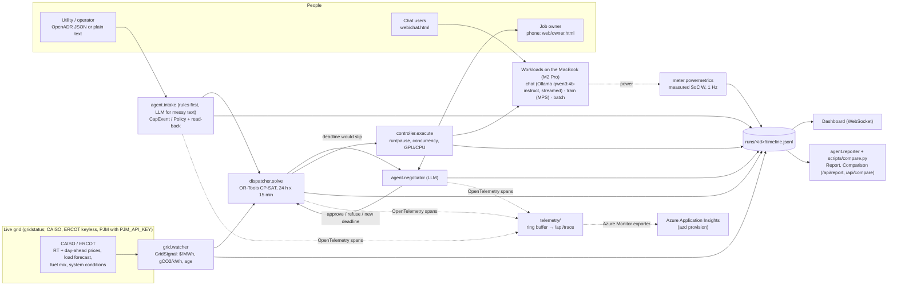

# Architecture

GitHub renders the diagram below. SPEC.md has the full interfaces; HANDOFF.md the API contract.

Rules the diagram encodes:
- The LLM (intake, negotiator, explainer) returns data only; the solver decides and the controller executes.
- Only `powermetrics` produces watts; only the ISO feeds produce prices and fuel mix.
- Reports and comparisons read the timeline and nothing else.
