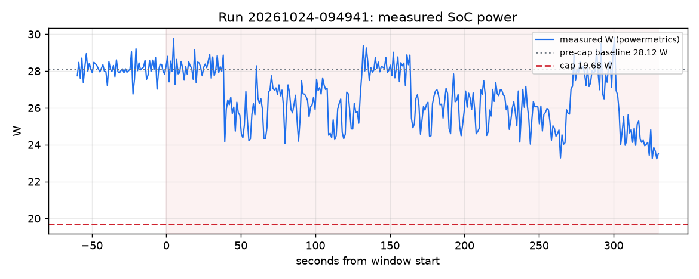

# Brownout report: run 20261024-094941

Window Sat 09:51:54 PDT to Sat 09:57:24 PDT (330 s). Computed from `/Users/AryenP/Library/Application Support/Claude/scratch-workspaces/f128f017-5645-4b80-984b-019e39d0fa8a/e2aef85f-8ca6-43e2-9534-dd1e1658a179/scratch-2026-10-24-7bcdbb/brownout/runs/20261024-094941/timeline.jsonl` only: watts are powermetrics samples (SoC: CPU + GPU + ANE), $ and gCO2 use the live price and fuel mix in effect at each second.

Cap event: scripted cap for the evidence run (source ui), 19.68 W for 1800 s from Sat 09:51:54 PDT (30 % below the measured baseline).

| Measure | Value |
|---|---|
| Pre-cap baseline (60 s mean) | 28.12 W |
| Cap window mean | 26.46 W |
| Reduction | 5.9 % |
| Time to compliance (10-s mean at or under cap) | n/a |
| Energy | 2.420 Wh |
| Cost at live price | $-0.000002 |
| Carbon at live mix | 0.246 gCO2 |
| Chat time-to-first-token p95, trailing 60 s (SLA 1 s): last before / worst during | 0.20 s / 4.56 s |
| Chat total-latency p95, trailing 60 s (reported, not an SLA): last before / worst during | 13.36 s / 13.36 s |

## Deadlines

- train: MISSED (due Sat 11:42:02 PDT; not finished yet, judged on the latest schedule sched-361890a3)

## Approvals

- Sat 09:51:56 PDT: asked ml-team about train: expired
- Sat 09:52:26 PDT: asked ops about power_cap: pending

## Shortfalls and caveats

- keeping the cap, train needs 30 more min of GPU time after its deadline
- keeping every deadline, power exceeds the cap by up to 7.45 W in 2 slot(s) from 09:45
- keeping every deadline, power exceeds the cap by up to 19.76 W in 3 slot(s) from 09:45
- keeping every deadline, power exceeds the cap by up to 23.33 W in 3 slot(s) from 09:45
- keeping every deadline, power exceeds the cap by up to 23.92 W in 3 slot(s) from 09:45
- keeping every deadline, power exceeds the cap by up to 23.38 W in 3 slot(s) from 09:45
- keeping every deadline, power exceeds the cap by up to 25.87 W in 3 slot(s) from 09:45
- keeping every deadline, power exceeds the cap by up to 23.76 W in 3 slot(s) from 09:45
- keeping every deadline, power exceeds the cap by up to 23.25 W in 3 slot(s) from 09:45
- keeping every deadline, power exceeds the cap by up to 25.43 W in 3 slot(s) from 09:45
- keeping every deadline, power exceeds the cap by up to 23.02 W in 3 slot(s) from 09:45
- the 10-s mean never reached the 19.68 W cap in the window

