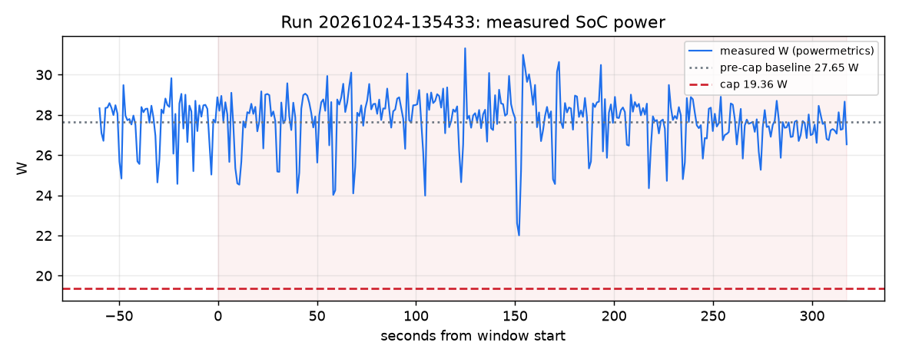

# Brownout report: run 20261024-135433

Window Sat 13:57:16 PDT to Sat 14:02:33 PDT (317 s). Computed from `/Users/AryenP/Library/Application Support/Claude/scratch-workspaces/f128f017-5645-4b80-984b-019e39d0fa8a/e2aef85f-8ca6-43e2-9534-dd1e1658a179/scratch-2026-10-24-7bcdbb/brownout/runs/20261024-135433/timeline.jsonl` only: watts are powermetrics samples (SoC: CPU + GPU + ANE), $ and gCO2 use the live price and fuel mix in effect at each second.

Cap event: scripted cap for the evidence run (source ui), 19.36 W for 1800 s from Sat 13:57:16 PDT (30 % below the measured baseline).

| Measure | Value |
|---|---|
| Pre-cap baseline (60 s mean) | 27.65 W |
| Cap window mean | 27.76 W |
| Reduction | -0.4 % |
| Time to compliance (10-s mean at or under cap) | n/a |
| Energy | 2.442 Wh |
| Cost at live price | $-0.000004 |
| Carbon at live mix | 0.217 gCO2 |
| Chat time-to-first-token p95, trailing 60 s (SLA 1 s): last before / worst during | 0.06 s / 0.08 s |
| Chat total-latency p95, trailing 60 s (reported, not an SLA): last before / worst during | 7.07 s / 7.91 s |

## Deadlines

- train: MISSED (due Sat 15:47:13 PDT; not finished yet, judged on the latest schedule sched-c70a9880)

## Approvals

- Sat 13:57:32 PDT: asked ops about power_cap: pending

## Shortfalls and caveats

- keeping every deadline, power exceeds the cap by up to 28.95 W in 3 slot(s) from 13:45
- keeping every deadline, power exceeds the cap by up to 28.95 W in 2 slot(s) from 14:00
- the 10-s mean never reached the 19.36 W cap in the window

