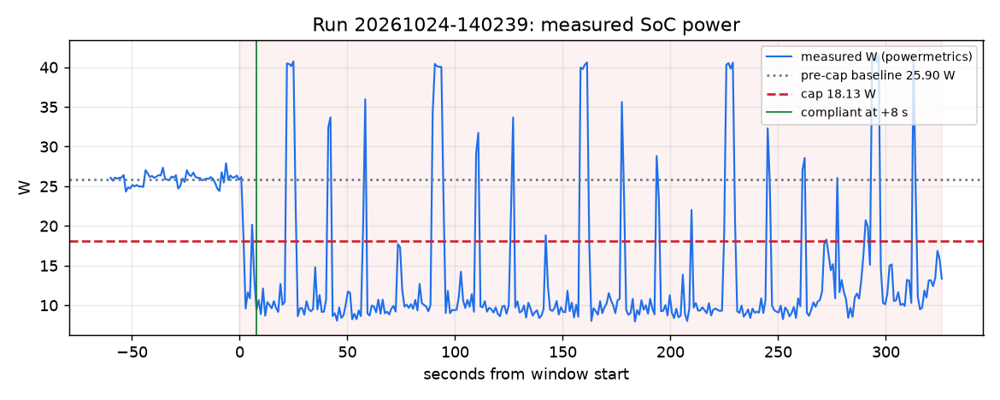

# Brownout report: run 20261024-140239

Window Sat 14:04:54 PDT to Sat 14:10:20 PDT (326 s). Computed from `docs/evidence/runs/20261024-140239/timeline.jsonl.gz` only: watts are powermetrics samples (SoC: CPU + GPU + ANE), $ and gCO2 use the live price and fuel mix in effect at each second.

Cap event: scripted cap for the evidence run (source ui), 18.13 W for 1800 s from Sat 14:04:54 PDT (30 % below the measured baseline).

| Measure | Value |
|---|---|
| Pre-cap baseline (60 s mean) | 25.90 W |
| Cap window mean | 13.70 W |
| Reduction | 47.1 % |
| Time to compliance (10-s mean at or under cap) | 8 s |
| Energy | 1.236 Wh |
| Cost at live price | $-0.000002 |
| Carbon at live mix | 0.109 gCO2 |
| Chat time-to-first-token p95, trailing 60 s (SLA 1 s): last before / worst during | 0.19 s / 0.19 s |
| Chat total-latency p95, trailing 60 s (reported, not an SLA): last before / worst during | 8.97 s / 8.97 s |

## Deadlines

- train: MISSED (due Sat 15:55:00 PDT; not finished yet, judged on the latest schedule sched-4df2cea9)

## Approvals

- Sat 14:05:02 PDT: asked ml-team about train: pending

## Shortfalls and caveats

- keeping the cap, train needs 26 more min of GPU time after its deadline
- keeping every deadline, power exceeds the cap by up to 18.27 W in 2 slot(s) from 14:00
- load outside the plan up to 11.55 W was measured and counted against the cap (9 re-solve(s) for it): the window's watts include it

