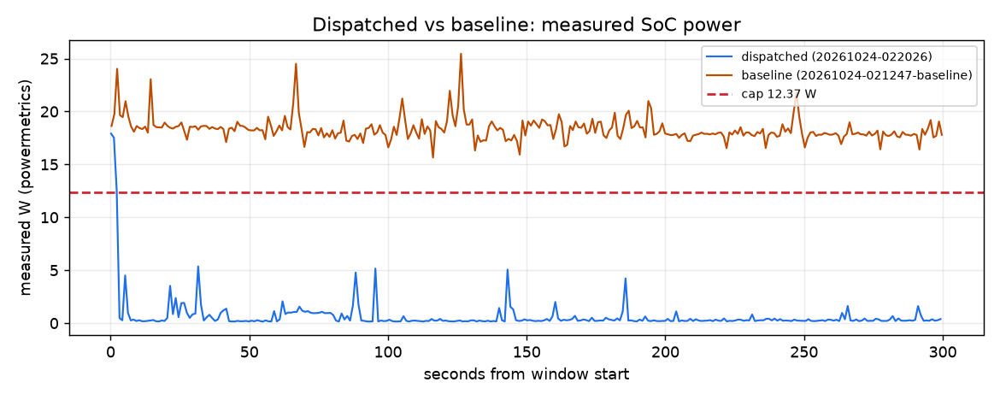

# Dispatched vs baseline over 300 s

Dispatched run `20261024-022026` vs dispatcher-off run `20261024-021247-baseline`. Computed from their timelines only (powermetrics watts; each run priced at the live price and fuel mix it had).

| Measure | Dispatched | Baseline | Dispatched minus baseline |
|---|---|---|---|
| Cost at live price | $0.000003 | $0.000079 | -0.000076 |
| Carbon at live mix | 0.017 g | 0.493 g | -0.476 g |
| Energy (measured) | 0.054 Wh | 1.524 Wh | -1.470 Wh |
| Mean power | 0.68 W | 18.32 W | -17.65 W |
| Time to compliance | 5 s | n/a |  |
| Deadlines met | 1/1 | 1/1 | +0 |
| Chat time-to-first-token p95, worst trailing 60 s (SLA 1 s) | n/a | n/a |  |
| Chat total-latency p95, worst trailing 60 s (reported, not an SLA) | n/a | n/a | |
| Measured seconds at or under the cap | 99 % | 0 % | +99 points |

## Notes

- dispatched run 20261024-022026: 300 s from its cap start Sat 02:22:35 PDT
- baseline run 20261024-021247-baseline: 300 s from its cap start Sat 02:14:56 PDT
- cap 12.37 W (the dispatched run's, else the baseline's) applied to both runs
- measured seconds at or under the cap: dispatched 99 %, baseline 0 %

## Shortfalls and caveats

- baseline: the 10-s mean never reached the 13.60 W cap in the window

