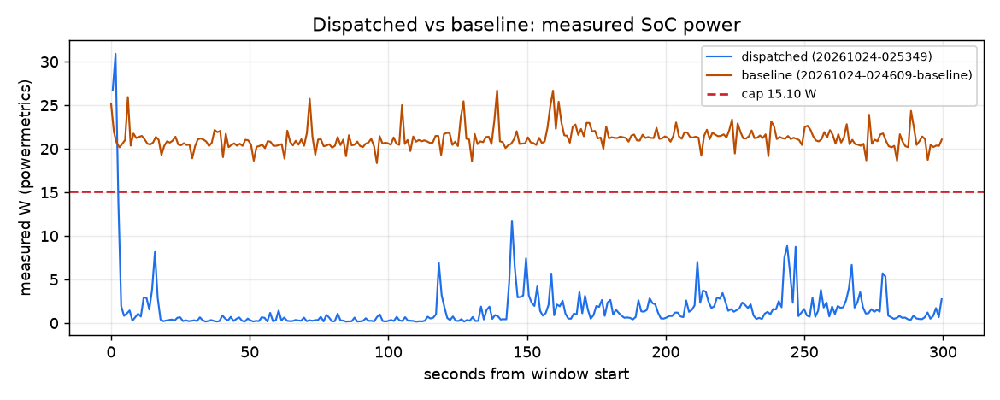

# Dispatched vs baseline over 300 s

Dispatched run `20261024-025349` vs dispatcher-off run `20261024-024609-baseline`. Computed from their timelines only (powermetrics watts; each run priced at the live price and fuel mix it had).

| Measure | Dispatched | Baseline | Dispatched minus baseline |
|---|---|---|---|
| Cost at live price | $0.000006 | $0.000084 | -0.000077 |
| Carbon at live mix | 0.043 g | 0.573 g | -0.530 g |
| Energy (measured) | 0.132 Wh | 1.761 Wh | -1.629 Wh |
| Mean power | 1.64 W | 21.18 W | -19.54 W |
| Time to compliance | 7 s | n/a |  |
| Deadlines met | 1/1 | 1/1 | +0 |
| Chat time-to-first-token p95, worst trailing 60 s (SLA 1 s) | n/a | n/a |  |
| Chat total-latency p95, worst trailing 60 s (reported, not an SLA) | n/a | n/a | |
| Measured seconds at or under the cap | 99 % | 0 % | +99 points |

## Notes

- dispatched run 20261024-025349: 300 s from its cap start Sat 02:56:02 PDT
- baseline run 20261024-024609-baseline: 300 s from its cap start Sat 02:48:22 PDT
- cap 15.10 W (the dispatched run's, else the baseline's) applied to both runs
- measured seconds at or under the cap: dispatched 99 %, baseline 0 %

## Shortfalls and caveats

- baseline: the 10-s mean never reached the 15.27 W cap in the window

