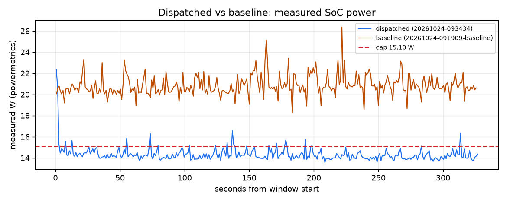

# Dispatched vs baseline over 327 s

Dispatched run `20261024-093434` vs `baseline` run `20261024-091909-baseline`. Computed from their timelines only (powermetrics watts; each run priced at the live price and fuel mix it had).

| Measure | Dispatched | Baseline | Dispatched minus baseline |
|---|---|---|---|
| Cost at live price | $0.000002 | $0.000009 | -0.000008 |
| Carbon at live mix | 0.133 g | 0.201 g | -0.068 g |
| Energy (measured) | 1.297 Wh | 1.881 Wh | -0.584 Wh |
| Mean power | 14.34 W | 20.85 W | -6.52 W |
| Time to compliance | 12 s | n/a |  |
| Deadlines met | 0/1 | 1/1 | -1 |
| Chat time-to-first-token p95, worst trailing 60 s (SLA 1 s) | n/a | n/a |  |
| Chat total-latency p95, worst trailing 60 s (reported, not an SLA) | n/a | n/a | |
| Measured seconds at or under the cap | 93 % | 0 % | +93 points |
| Training done in the window (steps, measured) | 1625 | 5899 | -4274 |
| Batch done in the window (items, measured) | n/a | 0 |  |

## Notes

- dispatched run 20261024-093434: 327 s from its cap start Sat 09:36:46 PDT
- baseline run 20261024-091909-baseline: 327 s from its cap start Sat 09:21:20 PDT
- cap 15.10 W (the dispatched run's, else the baseline's) applied to both runs
- measured seconds at or under the cap: dispatched 93 %, baseline 0 %

## Shortfalls and caveats

- dispatched: keeping the cap, train needs 19 more min of GPU time after its deadline
- dispatched: keeping every deadline, power exceeds the cap by up to 6.02 W in 2 slot(s) from 09:30
- dispatched: keeping the cap, train needs 18 more min of GPU time after its deadline
- baseline: keeping the cap, train needs 19 more min of GPU time after its deadline
- baseline: keeping every deadline, power exceeds the cap by up to 5.78 W in 2 slot(s) from 09:15
- baseline: keeping the cap, train needs 16 more min of GPU time after its deadline
- baseline: the 10-s mean never reached the 15.35 W cap in the window
- baseline: batch had already finished at Sat 09:20:28 PDT, before the window: its work in the window is 0 by construction

