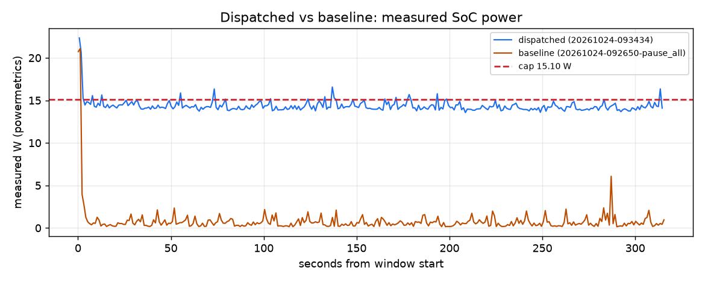

# Dispatched vs baseline over 315 s

Dispatched run `20261024-093434` vs `pause_all` run `20261024-092650-pause_all`. Computed from their timelines only (powermetrics watts; each run priced at the live price and fuel mix it had).

| Measure | Dispatched | Baseline | Dispatched minus baseline |
|---|---|---|---|
| Cost at live price | $0.000002 | $0.000000 | +0.000002 |
| Carbon at live mix | 0.128 g | 0.007 g | +0.121 g |
| Energy (measured) | 1.249 Wh | 0.067 Wh | +1.182 Wh |
| Mean power | 14.34 W | 0.80 W | +13.54 W |
| Time to compliance | 12 s | 4 s | +8 s |
| Deadlines met | 0/1 | 0/1 | +0 |
| Chat time-to-first-token p95, worst trailing 60 s (SLA 1 s) | n/a | n/a |  |
| Chat total-latency p95, worst trailing 60 s (reported, not an SLA) | n/a | n/a | |
| Measured seconds at or under the cap | 93 % | 99 % | -6 points |
| Training done in the window (steps, measured) | 1575 | 19 | +1556 |
| Batch done in the window (items, measured) | n/a | 0 |  |

## Notes

- dispatched run 20261024-093434: 315 s from its cap start Sat 09:36:46 PDT
- baseline run 20261024-092650-pause_all: 315 s from its cap start Sat 09:29:16 PDT
- cap 15.10 W (the dispatched run's, else the baseline's) applied to both runs
- measured seconds at or under the cap: dispatched 93 %, baseline 99 %

## Shortfalls and caveats

- dispatched: keeping the cap, train needs 19 more min of GPU time after its deadline
- dispatched: keeping every deadline, power exceeds the cap by up to 6.02 W in 2 slot(s) from 09:30
- baseline: keeping every deadline, power exceeds the cap by up to 5.76 W in 1 slot(s) from 09:15
- baseline: keeping the cap, train needs 8 more min of GPU time after its deadline
- baseline: batch had already finished at Sat 09:28:23 PDT, before the window: its work in the window is 0 by construction

